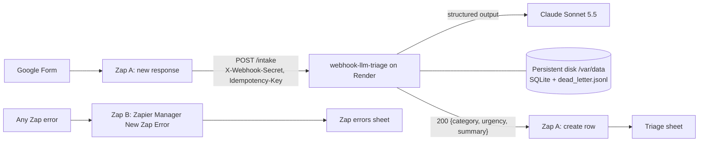

# webhook-llm-triage

[](https://github.com/nilhemdot/webhook-llm-triage/actions/workflows/ci.yml)

A small FastAPI service that a Zap calls for every new web-form submission. It asks Claude for a strict triage result (category, urgency, one-line summary) and returns it within Zapier's 30-second limit, with dedupe, dead letters, replay and a daily cap for when things go wrong.

## How it fits together



- **Categories:** `quote_request`, `support_ticket`, `access_request`, `renewal_or_billing`, `vendor_or_partner`, `other`.
- **Urgency:** `high` = an outage, a security issue or a user blocked from working; `medium` = a deadline within about a week, or a dated renewal or quote; `low` = everything else.
- Terms used throughout the code and docs are defined in [GLOSSARY.md](GLOSSARY.md).

## Quick start

Needs [uv](https://docs.astral.sh/uv/) (it installs the right Python from `.python-version`).

```sh
git clone https://github.com/nilhemdot/webhook-llm-triage.git
cd webhook-llm-triage
uv sync
uv run pytest -q    # fakes Claude: no network, no credentials
WEBHOOK_SECRET=change-me uv run uvicorn app.main:app --no-access-log
```

In another terminal:

```sh
curl -s localhost:8000/healthz    # {"ok":true}
```

Classifying a real intake event needs a Claude credential the SDK finds on its own (`ant auth login`, or `ANTHROPIC_API_KEY`):

```sh
curl -s localhost:8000/intake -H 'Content-Type: application/json' -H 'X-Webhook-Secret: change-me' \
  -d '{"name":"Demo","company":"Example Corp","email":"demo@example.com","subject":"VPN down","message":"Nobody in the office can connect to the VPN since 8am."}'
```

Settings come from the environment only; [.env.example](.env.example) lists them all. State goes to `DATA_DIR` (`./data` by default).

## HTTP contract

`POST /intake` with header `X-Webhook-Secret` (required) and `Idempotency-Key` (optional; Zap A sends the form response ID). Body: `name`, `company`, `email`, `subject` (≤ 300 chars), `message` (1–20,000 chars); whole body ≤ 64 KB.

Success is **200** `{"event_id": ..., "status": "processed" | "duplicate", "triage": {"category": ..., "urgency": ..., "summary": ...}}`. A duplicate is answered from the stored triage result without calling Claude. `GET /healthz` returns `{"ok": true}`.

## Failure modes

Zapier's Webhooks POST step errors on any non-2xx response, so the Zap run shows **Errored** and Zap B logs it to the errors sheet. "Dead letter" means the intake event is saved to `DATA_DIR/dead_letter.jsonl` and can be re-sent with `scripts/replay_dlq.py`; "Zap replay" means replaying the run from Zap History. Full steps are in [RUNBOOK.md](RUNBOOK.md).

| Status | Error | Cause | Dead letter? | Recovery |
|---|---|---|---|---|
| 400 | `malformed_json` | The body is not valid JSON (a broken Zap step). | Yes | Fix the Zap's Data mapping, then Zap replay. A replay of this dead letter fails again. |
| 401 | `unauthorized` | `X-Webhook-Secret` missing or wrong, or `WEBHOOK_SECRET` not set on the service. Body is `{"detail": "unauthorized"}`. | No | Fix the header in Zap A or the env var on Render, then Zap replay. |
| 413 | `payload_too_large` | Body over 64 KB, or no `Content-Length`. | No | Shorten the submission or fix the Zap step, then Zap replay. |
| 422 | `invalid_payload` | Valid JSON, but a field is missing or too long; `details` lists each field. | Yes | Fix the Zap's field mapping, then Zap replay. A replay of this dead letter fails again. |
| 429 | `daily_cap_reached` | `MAX_EVENTS_PER_DAY` LLM-calling intake events already today (UTC). | No | Wait for 00:00 UTC (or raise the cap on purpose), then Zap replay. |
| 500 | `config_error` | Claude has no credential, rejects it (401/403), or rejects the request (other 4xx, e.g. an unknown `ANTHROPIC_MODEL`). | Yes | Fix the configuration; then replay dead letters. Replaying before the fix only fails again. |
| 500 | `internal_error` | An unexpected exception (a bug). Body is plain text `Internal Server Error`; the log line says `internal_error`. | Yes | Read the log line and dead letter, fix the bug, then replay dead letters. |
| 502 | `llm_invalid_output` | Claude's reply was not a valid triage result twice in a row. | Yes | Replay dead letters; if it repeats for one event, triage it by hand. |
| 502 | `llm_refused` | Claude declined, even after the server-side fallbacks. | Yes | Triage it by hand; a replay will most likely be declined again. |
| 503 | `llm_unavailable` | Claude rate limit, 5xx or overload, or a connection error (after one SDK retry). | Yes | Temporary: replay dead letters (or Zap replay) once Claude recovers. |
| 504 | `llm_timeout` | A Claude call timed out (8 s), or the 20 s time budget ran out. | Yes | Temporary: replay dead letters (or Zap replay). |

Every request leaves one JSON log line (`event_id`, `path`, `status`, `latency_ms`, `outcome`, `error`) with no message text, email addresses or secrets. A written trace of one failure is in [docs/FAILURE_TRACE.md](docs/FAILURE_TRACE.md); classifier results on test submissions are in [docs/UAT.md](docs/UAT.md).

## Dead letters and replay

Every intake event that fails after the webhook secret check (400, 422, 500, 502, 503, 504) is appended to `DATA_DIR/dead_letter.jsonl` with its event id, idempotency key, received time, reason, error and **full payload**. The payload is kept so the event can be replayed; it goes to that file only, never to the logs.

```sh
DATA_DIR=/var/data uv run python scripts/replay_dlq.py --url https://<app>.onrender.com --dry-run  # list only
DATA_DIR=/var/data uv run python scripts/replay_dlq.py --url https://<app>.onrender.com
```

The tool reads the webhook secret from the `WEBHOOK_SECRET` environment variable only (never put it on the command line) and exits with an error if it is unset. It warns if `--url` is `http://`, since the secret would then travel unencrypted.

A real run re-sends each dead letter with its original `Idempotency-Key`, moves successes to `dead_letter.replayed.jsonl`, keeps failures and exits 1 if any remain. It also deletes entries older than 14 days from both files. Replay requests carry `X-Dead-Letter-Replay` with the original received time: a replay that fails again after the secret check is dead-lettered again with its new reason and error, replacing the old entry, and still ages out 14 days after it was first received.

## Deploy

[render.yaml](render.yaml) is a Render Blueprint: a paid `starter` web service with a 1 GB persistent disk at `/var/data`, a health check on `/healthz`, and `WEBHOOK_SECRET` / `ANTHROPIC_API_KEY` prompted in the dashboard (never committed). The API key should come from an Anthropic Console workspace with a monthly spend limit. See [SECURITY.md](SECURITY.md).

## Smoke test against the real Claude API

The test suite fakes Claude. To make one real call with the configured model, structured output and server-side fallbacks:

```sh
ant auth login            # or export ANTHROPIC_API_KEY=...
uv run python scripts/smoke.py
```

It prints the model and the triage result for a sample intake event. If the API rejects the `server-side-fallback-2026-07-01` beta, drop `betas`/`fallbacks` in `app/classifier.py` and note it here.

## Known limitations

- **One instance only.** State is SQLite and a JSONL file on one persistent disk, so the service can't scale out.
- **Short downtime on every deploy.** A service with a disk gets no zero-downtime deploys; intake events that arrive in the gap error in Zapier and need a Zap replay.
- **Duplicates can add a second sheet row.** A duplicate is answered 200 with `status: "duplicate"`, so Zap A's Sheets step still runs. Add a Filter step ("only continue if `status` is `processed`") before it if that matters.
- **Two simultaneous deliveries of the same intake event** can both call Claude; the first stored result wins.
- **Retention runs with the replay tool.** Dead letters older than 14 days are deleted only when `scripts/replay_dlq.py` runs (dry runs delete nothing). Processed intake events, including their summaries, stay in SQLite.
- **Zapier plan.** Zap A uses Webhooks by Zapier and three steps, which need a paid plan or the 14-day trial; Zap B works on Free.
- **Shared-secret auth only:** no HMAC request signing.

## Docs

[RUNBOOK.md](RUNBOOK.md) · [SECURITY.md](SECURITY.md) · [docs/UAT.md](docs/UAT.md) · [docs/FAILURE_TRACE.md](docs/FAILURE_TRACE.md) · [GLOSSARY.md](GLOSSARY.md) · [LICENSE](LICENSE) (MIT)
